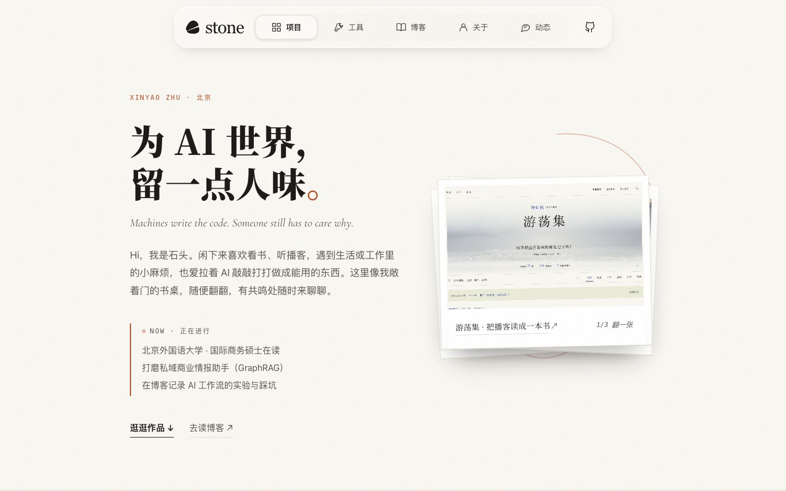
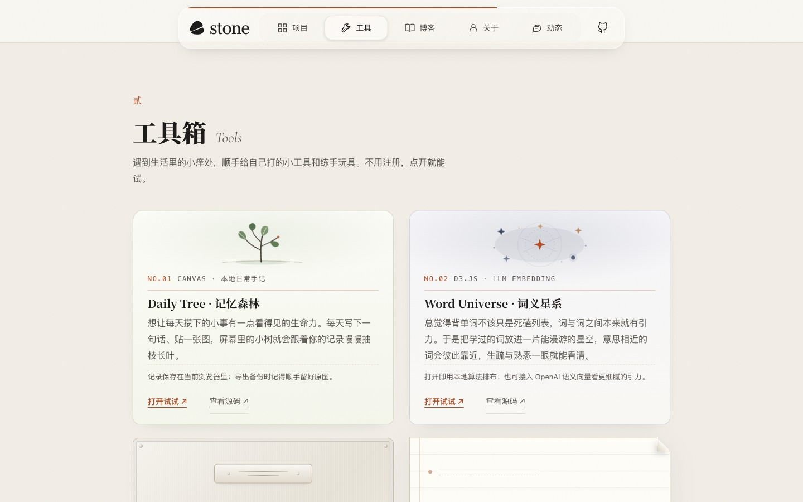

<div align="center">

# stone · 个人网站

**把作品、写作与日常 Moments 收在同一张敞着门的书桌上。**

<p>
  <a href="https://heystone.site/"><strong>访问 heystone.site ↗</strong></a> ·
  <a href="https://blog.heystone.site/">独立博客</a> ·
  <a href="https://youdang.heystone.site/">游荡集</a> ·
  <a href="https://read.heystone.site/">Research Edition</a> ·
  <a href="#english">English</a>
</p>

<br />



</div>

## 为什么做它

比起把项目链接排成冷冰冰的简历列表，我更想搭一间虚掩着门、留着一盏台灯的书房——访客推门进来，能直接翻看作品、在页内试玩小游戏、逛一逛顺手造的工具箱，顺便顺着文字认识一个真实的人。

整站沿用 [BRAND.md](BRAND.md) 定稿的视觉气质：**暖纸白 `#FAF7F2` · 墨黑 `#1C1917` · 陶土橙 `#C2410C`**，加上小写衬线 `stone` 字标与石头书页留白标记。

## 页面一览

|  |  |
| :---: | :---: |
| *首屏：可翻看的叠放作品照片、Now 状态与阅读入口* | *工具箱：为每件独立小工具定制的微动画卡片舞台* |

- **代表作展区**：收录猎光智能招聘系统（含可点选的虚构简历体验卡）、`Product Quest` 页内直玩框、《游荡集》播客精读站与 `Research Edition` 深度阅读室。
- **工具箱（Tools）**：以小树、星轨、铸铁铭牌与折页四种物理意象，串起 `Daily Tree`、`Word Universe`、`铁证 IRONPROOF` 与早期原型留档。
- **Moments 动态流**：支持个人文字与图片记录，搭配独立的轻量服务端认证与媒体存储逻辑。
- **克制的细节彩蛋**：页尾可点亮的书桌台灯、加载过渡小场景与一键复制邮箱提示。

## 快速开始

需要 Node.js（CI 使用 Node.js 24）与 npm：

```bash
git clone https://github.com/nuts-and-bytes/stone-site.git
cd stone-site
npm ci
npm run dev
```

构建生产产物与本地预览：

```bash
npm run build
npm run preview
```

<details>
<summary><strong>目录结构、部署方式与使用边界</strong></summary>

<br />

- `src/pages/`：首页（`Home.jsx`）与动态页（`Moments.jsx`）
- `src/components/`：叠放照片、猎光简历演示、工具箱组件、书桌角落与导航
- `src/config.js`：博客与 GitHub Pages 子项目统一地址配置
- `public/brand/`：可编辑矢量源与品牌资产（规范见 [BRAND.md](BRAND.md)）
- `api/`、`server/`、`tests/`：Moments 读写鉴权、存储逻辑与 Node.js 测试
- **部署与边界**：推送 `main` 会通过 [.github/workflows/deploy.yml](.github/workflows/deploy.yml) 自动构建发布；Moments 写入能力依赖独立部署的服务端认证与存储配置，纯静态托管仅提供只读展示。代码采用 MIT License，个人文字、照片与 `stone` 品牌素材保留全部权利，详见 [LICENSE](LICENSE)。

</details>

## English

Source code for **[heystone.site](https://heystone.site/)** — the personal website of Xinyao Zhu (**stone**), bringing together interactive projects, tools, essays, and Moments in a warm, editorial paper-and-ink design (`#FAF7F2` / `#1C1917` / `#C2410C`).

Run locally with `npm ci && npm run dev`, and build with `npm run build`. Moments write actions require separately configured server-side authentication and storage.

---

<p align="center">made by <a href="https://heystone.site/">stone</a> · 为 AI 世界留一点人味</p>
